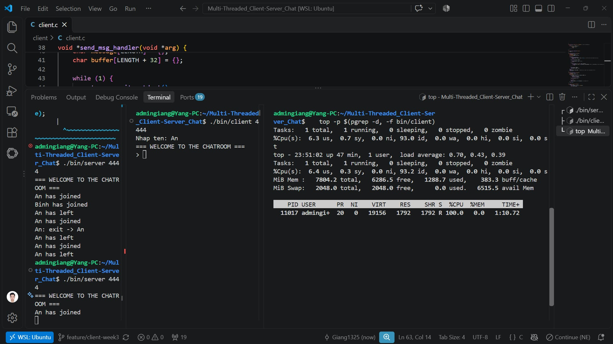
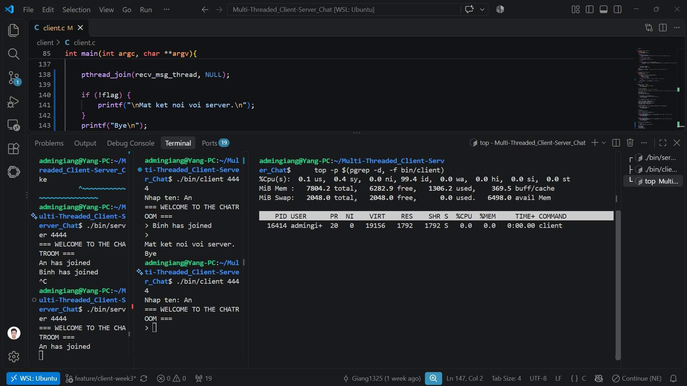
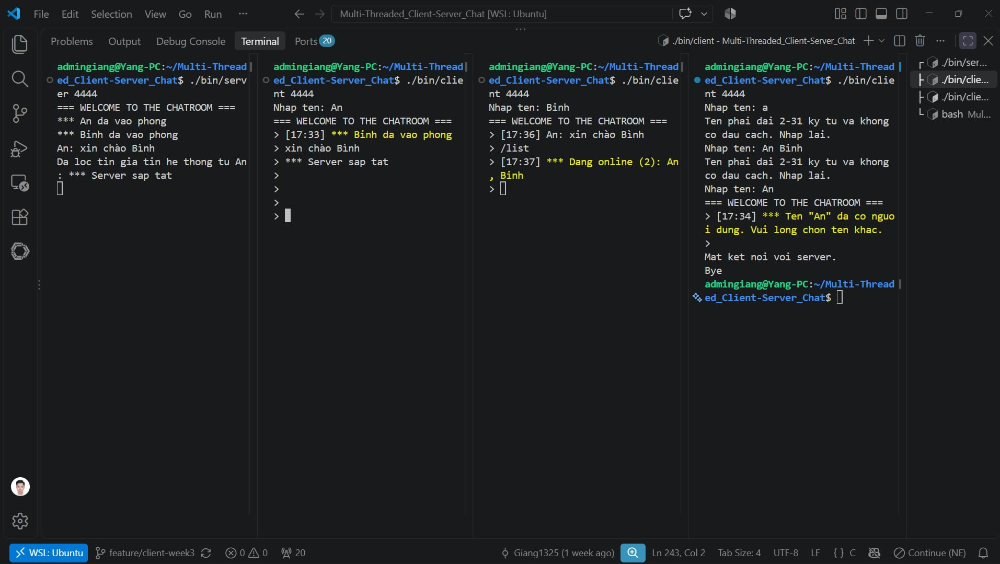
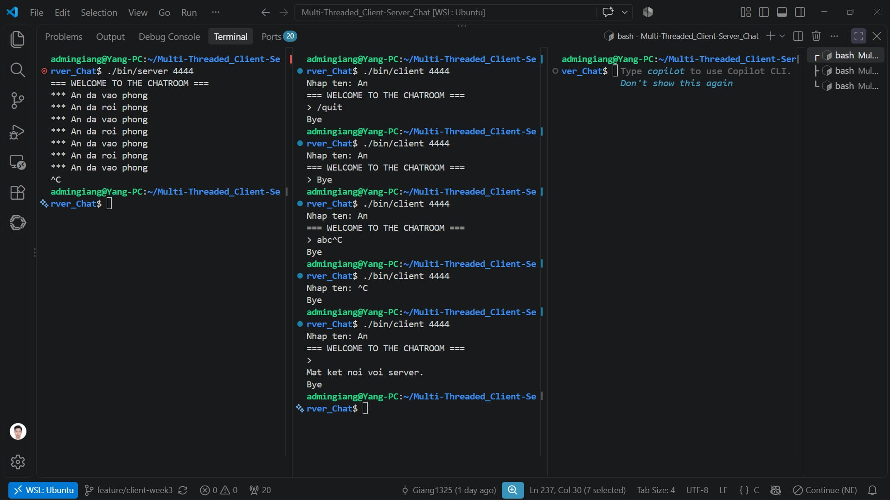
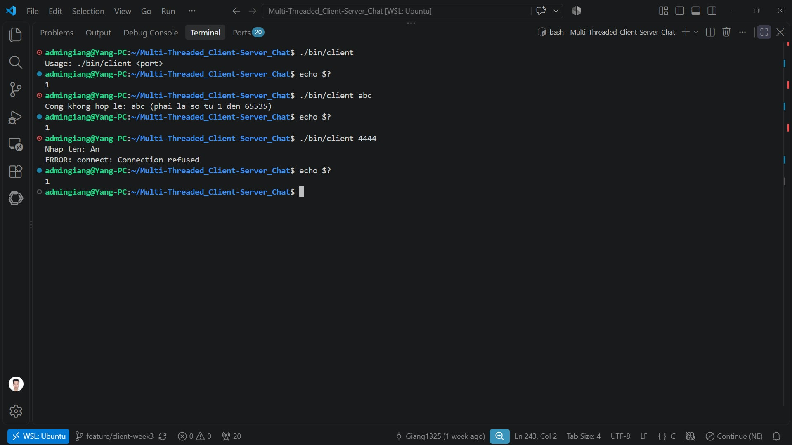

# Giải thích code Client (`client/client.c`)

Người viết: Nguyễn Trường Giang. Tham khảo [nikhilroxtomar/Chatroom-in-C](https://github.com/nikhilroxtomar/Chatroom-in-C), đã sửa ở tuần 3.

Chạy: `make`, rồi `./bin/server 4444` và `./bin/client 4444`. Khi chat: `/list` xem ai đang online, `/quit` hoặc Ctrl+D để rời phòng, Ctrl+C để thoát ngay.

---

# 1. Code client.c có những hàm nào? Chức năng của các hàm đó là gì?

Client dùng **3 luồng**, vì đọc bàn phím (`fgets`) và đọc mạng (`recv`) đều là lời gọi **bị chặn**, một luồng không làm được cả hai cùng lúc:

- **`main()`**: Luồng chính. Hỏi tên, kết nối, gửi tên, tạo 2 luồng con, rồi **chờ luồng nhận kết thúc bằng `pthread_join()`** và thoát.

- **`send_msg_handler()`**: Luồng gửi. Đọc bàn phím, gửi từng dòng lên server dạng `nội dung\n` (server tự gắn tên). Gặp `/quit` hoặc Ctrl+D thì gọi `shutdown()` để đánh thức luồng nhận.

- **`recv_msg_handler()`**: Luồng nhận. Nhận dữ liệu từ server, **tách thành từng dòng** theo `\n` rồi in. Cần tách vì TCP là dòng byte: một lần `recv` có thể chứa nhiều tin dính nhau hoặc nửa tin.

- **`print_msg()`**: Nơi duy nhất in tin ra màn hình. Thêm giờ `[HH:MM]` ở đầu; tin hệ thống (mở đầu bằng `*** `) in màu vàng.

- **`current_hhmm()`**: Lấy giờ:phút hiện tại bằng `time()`, `localtime_r()`, `strftime()`. Dùng `localtime_r` vì `localtime` dùng chung một biến, nhiều luồng gọi cùng lúc có thể ghi đè nhau.

- **`read_line()`**: Đọc một dòng từ bàn phím, bỏ `\n`. Dòng quá dài thì đọc bỏ phần thừa để nó không thành dòng tiếp theo.

- **`name_is_valid()`**: Kiểm tra tên dài 2–31 ký tự, không có dấu cách (cùng luật với server).

- **`parse_port()`**: Đổi chuỗi cổng sang số bằng `strtol()`, từ chối `abc`, `44ab`, số ngoài khoảng 1–65535 (thay cho `atoi` vốn không báo lỗi).

- **`catch_ctrl_c_and_exit()`**: Xử lý Ctrl+C (`SIGINT`): in `Bye` bằng `write()` rồi `_exit()`. Trong hàm xử lý tín hiệu chỉ được gọi hàm an toàn với tín hiệu (async-signal-safe); `printf`/`exit` có thể bị treo vì cần khóa của `stdout`/`stdin`.

---

# 2. Biến dùng chung

Ba luồng trong cùng một tiến trình dùng chung các biến toàn cục:

- **`sockfd`** (`int`): socket kết nối tới server.
- **`name`** (`char[32]`): tên người dùng.
- **`flag`** (`volatile sig_atomic_t`): bằng 1 khi **người dùng chủ động thoát** (`/quit`, Ctrl+D). Nếu luồng nhận kết thúc mà `flag` vẫn bằng 0 thì nghĩa là server đã đóng kết nối.

---

# 3. Luồng hoạt động

- **Hàm `main()`**:
  - **Bước 1**: Kiểm tra cổng (`parse_port`), đăng ký xử lý Ctrl+C.
  - **Bước 2**: Hỏi tên, sai thì hỏi lại (`read_line`, `name_is_valid`).
  - **Bước 3**: `socket()`, `connect()`, gửi `<tên>\n`. Lỗi thì in lý do bằng `perror` (ví dụ `Connection refused`) và thoát với mã 1.
  - **Bước 4**: Tạo luồng gửi và luồng nhận (`pthread_create`).
  - **Bước 5**: `pthread_join` chờ luồng nhận kết thúc, rồi in `Mat ket noi voi server.` (nếu `flag == 0`) và `Bye`, thoát bằng `_exit()`.

- **Mọi cách thoát đều làm luồng nhận kết thúc**:
  - *Server tắt*: `recv` trả về 0.
  - *`/quit`, Ctrl+D*: luồng gửi gọi `shutdown()`, làm `recv` trả về 0.
  - *Ctrl+C*: trường hợp riêng, hàm xử lý tín hiệu thoát ngay.

- **Vì sao thoát bằng `_exit()` mà không `return`?** Luồng gửi có thể đang chờ bàn phím trong `fgets` và **giữ khóa `stdin`**. `return`/`exit()` cần khóa đó để dọn dẹp nên sẽ chờ mãi. `_exit()` nhờ kernel kết thúc tiến trình ngay, không cần khóa.

---

# 4. Các lỗi của code mẫu đã sửa ở tuần 3

| Lỗi | Cách sửa |
|---|---|
| Server tắt thì client treo | `pthread_join` luồng nhận + `_exit` |
| Ctrl+C in `Bye` nhưng không thoát | Hàm xử lý tín hiệu gọi `write` + `_exit` |
| Ctrl+D làm ngập server (khoảng 3 MB/2 giây) | Kiểm tra `fgets` trả về `NULL` |
| Chờ bận ở luồng chính, 100% CPU | Thay vòng `while(1)` bằng `pthread_join` |
| Gửi vào kết nối đã đóng bị `SIGPIPE` giết | `send(..., MSG_NOSIGNAL)` và kiểm tra kết quả |
| Tên gửi 32 byte, không tương thích server mới | Gửi `<tên>\n` theo README |
| Tên quá dài: phần thừa thành tin đầu tiên | `read_line` đọc bỏ phần thừa, hỏi lại tên |
| `sprintf` có thể tràn bộ đệm 2 byte | Bỏ ghép tên, dùng `snprintf` |
| `recv` không chừa chỗ cho `\0` | Chừa 1 byte, tách dòng rồi đặt `\0` |
| Client tự gắn tên, mạo danh được | Chỉ gửi nội dung, server gắn tên |
| Hàm luồng sai dạng `void f()` | Viết đúng `void *f(void *arg)`, `return NULL` |
| Thiếu kiểm tra lỗi (`atoi`, `socket`, `connect`...) | `strtol`, `perror`, `strerror`, `memset` |

Biên dịch hiện **không còn cảnh báo nào**.

---

# 5. Kết quả thử nghiệm

**Đo CPU khi client đang chờ** (`top`): trước khi sửa 100% CPU, trạng thái `R`; sau khi sửa 0% CPU, trạng thái `S`.

**Thử với server thật** (15 mục, tất cả đạt):

| Nhóm | Các mục đã thử |
|---|---|
| Chat | Vào phòng, tên sai hỏi lại, trùng tên bị từ chối, gửi tin có dấu, `/list`, chặn tin giả `***`, bỏ qua dòng trống |
| Thoát | `/quit`, Ctrl+D, Ctrl+C khi đang gõ, Ctrl+C lúc nhập tên, server tắt |
| Báo lỗi | Thiếu tham số, cổng sai, server chưa chạy (mã thoát 1) |

---

# 6. Hạn chế còn lại

- IP cố định `127.0.0.1`: chỉ chạy được cùng máy với server.
- Tên có dấu bị giới hạn chặt hơn, vì 31 ký tự tính theo byte UTF-8.
- Đang gõ dở mà có tin đến thì màn hình bị lộn xộn.
- `WELCOME` được in trước khi server chấp nhận tên.
- Giờ hiển thị là giờ nhận, không phải giờ gửi.